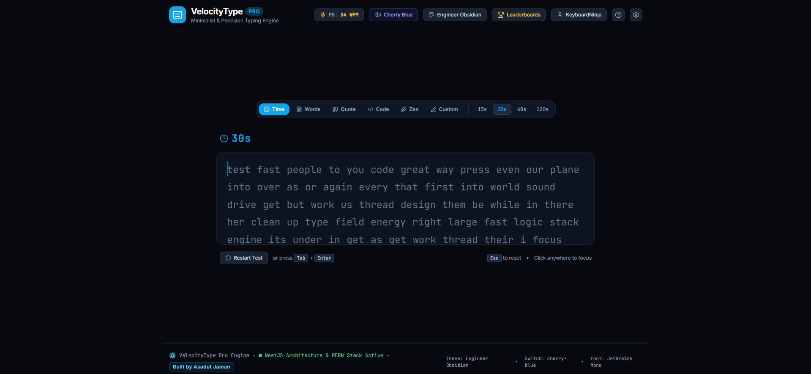
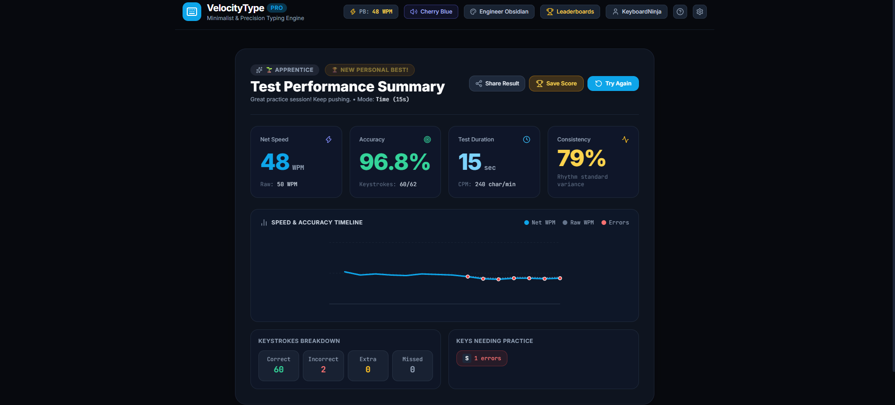
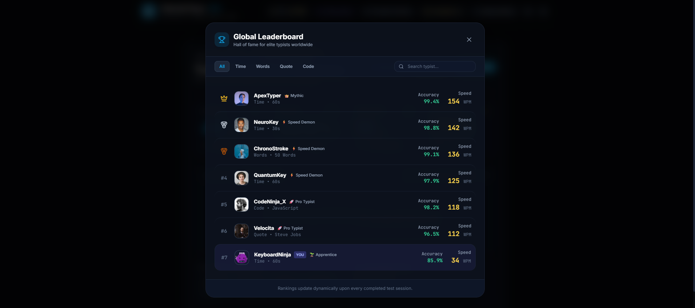

# ⚡ VelocityType Pro — Ultimate Typing Speed Challenge

<p align="center">
  A precision-engineered typing speed platform designed for developers, competitive typists, and productivity enthusiasts.
</p>

<p align="center">
  <a href="https://typing-speed-challenge-kappa.vercel.app/"><strong>🚀 Live Demo</strong></a>
</p>

---

## 📖 Overview

**VelocityType Pro** is a feature-rich typing speed and performance analysis platform inspired by Monkeytype, TypeRacer, and competitive esports typing environments.

It combines a responsive typing engine, real-time performance metrics, customizable challenges, mechanical keyboard sound effects, detailed analytics, and leaderboard functionality into one modern application.

The project follows a unified, single-project architecture, combining a React-based frontend with a modular, NestJS-inspired backend design and an Express REST API.


## 🌟 Key Features

### 1. 🎯 Precision Typing Engine

- **Real-Time Performance Metrics:** Instantly track Gross WPM, Net WPM, CPM, and typing accuracy.
- **Smooth Caret Animations:** Choose from four caret styles:
  - Smooth Line
  - Full Block
  - Underline
  - Pulsing Bar
- **Character-Level Feedback:** Color-coded highlighting for correct, incorrect, extra, and untyped characters.
- **Automatic Viewport Scrolling:** Keeps the active typing position visible.
- **Keyboard Shortcuts:**
  - `Tab + Enter` — Restart the current test.
  - `Esc` — Cancel or reset the session.
  - `Ctrl + Backspace` — Delete the active word.
  - `Space` — Submit the current word and advance.
- **Caps Lock Detection:** Displays a responsive warning when Caps Lock is enabled.

### 2. 🎛️ Multiple Challenge Modes

Practice typing through different challenge formats:

| Mode | Description |
|---|---|
| Time Challenge | 15, 30, 60, and 120-second tests |
| Word Challenge | 10, 25, 50, and 100-word tests |
| Famous Quotes | Inspirational quotes with author attribution |
| Code Mode | Programming challenges in JavaScript, TypeScript, Python, Rust, and HTML |
| Zen Mode | Unlimited typing without time pressure |
| Custom Text | Practice with your own articles, essays, and documents |

### 3. 🔊 Mechanical Keyboard Sound Engine

Experience immersive typing feedback with procedural sound synthesis using the **Web Audio API**.

Available sound profiles:

- **Cherry MX Blue:** Crisp mechanical clicks with tactile feedback.
- **Cherry MX Brown:** Soft, dampened mechanical thock.
- **Vintage Typewriter:** Classic typewriter-style mechanical sounds.
- **Bubble Pop:** Smooth and satisfying ASMR-inspired effects.

Additional controls:
- Adjustable volume.
- Instant mute/unmute.
- No external MP3 dependencies.

### 4. 📊 Performance Analytics & Visualization


Understand your typing performance with detailed analytics.

- **Live WPM Graph:** Visualize Net WPM and Raw WPM progression over time.
- **Error Tracking:** Identify typing mistakes throughout each session.
- **Keystroke Diagnostic Matrix:** Analyze correct, incorrect, extra, and missed characters.
- **Weak-Key Heatmap:** Identify frequently mistyped keys and improve accuracy.
- **Rhythm Consistency:** Measure typing consistency using a 0–100% metric.
- **Personal Best Tracking:** Celebrate new records with animated confetti.
- **Shareable Results:** Copy formatted performance summaries for Discord, Reddit, and X.

### 5. 🏆 Leaderboard & Player Profiles


Track your progress and compete with other typists.

- Global leaderboard with Gold, Silver, and Bronze rankings.
- Mode-specific leaderboard filters.
- Personal Best (PB) tracking.
- Average WPM and overall accuracy.
- Total tests completed.
- Total typing time.
- Historical session logs with timestamps.

### 6. 🎨 Custom Themes & Typography

Personalize your typing environment with six carefully designed themes:

| Theme | Design Style |
|---|---|
| Midnight Cyber | Deep slate, electric indigo, and neon cyan |
| Canary Gold | Dark charcoal with vibrant yellow |
| Dracula Synth | Midnight purple with neon accents |
| Matcha Forest | Forest green and emerald tones |
| Nordic Clean | Minimal, crisp, high-contrast light theme |
| Espresso Dusk | Warm coffee-inspired colors and amber accents |

**Typography Options:**
- JetBrains Mono
- Fira Code
- Roboto Mono
- Inter

---

## 🏗️ Architecture & Technology Stack

VelocityType Pro uses a unified project architecture with a modular backend design.

### Frontend

- React 19
- TypeScript
- Vite
- Tailwind CSS
- Lucide React
- Canvas Confetti
- Web Audio API

### Backend

- Node.js
- Express.js
- NestJS-inspired modular architecture
- REST API
- JSON-based local persistence

### REST API

The standalone Express API is implemented in `api-server.mjs`.

| Method | Endpoint | Description |
|---|---|---|
| GET | `/api/health` | Check API server status |
| GET | `/api/leaderboard` | Retrieve leaderboard data |
| POST | `/api/leaderboard` | Submit a new score |

**Data Persistence:** Uses a local `server-db.json` file, avoiding the need for an external database during local development.

> **Architecture Note:** The project uses a NestJS-inspired modular structure alongside Express.js. It is not a full NestJS application.

---

## 🚀 Getting Started

Follow these steps to run the project locally.

### Prerequisites

- Node.js (LTS recommended)
- npm
- Git

### 1. Clone the Repository

```bash
git clone YOUR_GITHUB_REPOSITORY_URL
cd VelocityType-Pro
```

### 2. Install Dependencies

```bash
npm install
```

### 3. Start the Frontend

```bash
npm run dev
```

Open the application:

`http://localhost:5173`

### 4. Start the Backend API (Optional)

Open another terminal in the project root:

```bash
node api-server.mjs
```

The REST API will be available at:

`http://localhost:5050`

### 5. Build for Production

```bash
npm run build
```

The optimized production build will be generated inside the `dist/` directory.

---

## 🌐 Live Application

<p align="center">
  <a href="https://typing-speed-challenge-kappa.vercel.app/">
    <strong>⚡ Experience VelocityType Pro</strong>
  </a>
</p>

**Live URL:** https://typing-speed-challenge-kappa.vercel.app/

---

## 👨‍💻 Developer

**Asadut Jaman**  
Software Engineer | Full-Stack MERN Developer

- GitHub: https://github.com/Asadul09
- Portfolio: https://portfolio-website-pi-five-83.vercel.app/

---

<p align="center">
  Built with ❤️ by <strong>Asadut Jaman</strong>
</p>

<p align="center">
  ⚡ Type Faster. Think Sharper. Go Beyond.
</p>
